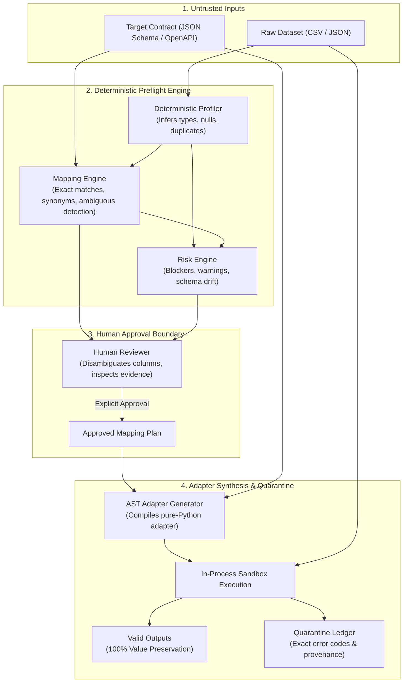

<div align="center">


<br/>
<br/>

[](https://www.python.org/)
[](https://fastapi.tiangolo.com/)
[](https://docs.pydantic.dev/)
[](https://docs.pytest.org/)
[](LICENSE)
[](#current-release-status)

<p align="center">
  <strong>Know what will break before you build the integration.</strong>
</p>

<p align="center">
  Recon is a developer-first preflight engine that catches mapping gaps, schema mismatches, and data-quality defects in third-party partner data batches before you write or deploy ingestion pipeline code.
</p>

[Quick Start](#quick-start) • [Workflow](#how-recon-works) • [CLI Usage](#cli-workflow--cicd-gate) • [Architecture](#architecture) • [Security Boundary](#security-model) • [Documentation](docs/)

</div>

---

## The Problem: Why Integrations Fail Late

When integrating data feeds from external vendors, partners, or legacy systems, teams typically discover breaking issues **downstream at runtime**:

1. **Header Misalignment:** The partner exports `doc_number` and `gst_reg_no`, while your system requires `invoice_id` and `supplier_gstin`. Schema validators reject the entire batch because expected fields are missing.
2. **Ambiguous Columns:** A partner feed contains both `bill_to_zip` and `ship_to_zip`. Hand-rolled scripts arbitrarily pick one or drop the other, silently corrupting downstream data.
3. **Subtle Data Quality Defects:** Valid-looking feeds contain dirty edge cases—currency strings in float columns (`"₹ 1,50,000.00"`), regex pattern violations on tax IDs, leading zeros truncated into integers (`"00142"` $\to$ `142`), or invalid status enums.
4. **Data Loss:** Typical custom ETL scripts drop failing records silently or crash halfway through a batch, violating data provenance.

Recon moves integration validation **upstream to preflight**.

---

## What Recon Does

Recon audits unfamiliar source datasets against your target schema contracts before you build an ingestion pipeline:

- **Deterministic Profiling:** Automatically infers column data types, null percentages, distinct counts, whitespace anomalies, and duplicate rows.
- **Evidence-Backed Mapping:** Proposes column alignments with verifiable evidence (naming heuristics, type compatibility, sample value inspections).
- **Zero-Guessing Guardrails:** Flags ambiguous candidate columns and leaves unmapped required fields `UNRESOLVED`. Strictly blocks execution until an engineer explicitly approves the mapping plan.
- **Pure-Python AST Synthesis:** Compiles approved mapping decisions into a standalone, reviewable Python adapter.
- **Zero-Loss Quarantine Accounting:** Validates data transformations in an isolated sandbox, guaranteeing the mathematical invariant:
  $$N_{\text{total\_input}} \equiv N_{\text{valid\_output}} + N_{\text{quarantined\_records}}$$
- **Headless CI/CD Gate:** Evaluates incoming datasets headlessly via `recon gate` with configurable quarantine thresholds and machine-readable JSON output.

---

## How Recon Works



---

## Quick Start

### Prerequisites
- Python 3.11+
- Git

### Installation

```bash
# Clone the repository
git clone https://github.com/swamigawai/recon.git
cd recon

# Create and activate virtual environment
python -m venv .venv
source .venv/bin/activate  # On Windows: .venv\Scripts\Activate.ps1

# Install Recon in editable mode with development dependencies
python -m pip install --upgrade pip
python -m pip install -e ".[dev]"

# Verify installation with test suite
pytest -q
# Expected: 152 passed
```

### Launch Local Preflight Studio

Start the local developer web studio:

```bash
recon serve --port 8000
```

Open your browser to: **[http://localhost:8000](http://localhost:8000)**

---

## A Real Example: B2B Enterprise Vendor Invoicing

Using the verified checked-in pilot fixtures:
- **Source:** [`tests/fixtures/gate09_pilot_b2b_vendor_invoices.csv`](tests/fixtures/gate09_pilot_b2b_vendor_invoices.csv) (12 records)
- **Target Contract:** [`tests/fixtures/target_contract_gate09_pilot_b2b.json`](tests/fixtures/target_contract_gate09_pilot_b2b.json) (11 fields)

### 1. Preflight CLI Assessment

```bash
recon assess tests/fixtures/gate09_pilot_b2b_vendor_invoices.csv tests/fixtures/target_contract_gate09_pilot_b2b.json
```

```text
======================================================================
RECON RISK ASSESSMENT: gate09_pilot_b2b_vendor_invoices.csv -> target_contract_gate09_pilot_b2b
======================================================================
Findings: 4 (Critical: 4, High: 0, Medium: 0, Low: 0)
Status:   BLOCKED
----------------------------------------------------------------------
[CRITICAL] R001_MISSING_REQUIRED_FIELD: Missing Required Target Field Mapping
  Fields: invoice_id
  Evidence: Target field 'invoice_id' is required, but no source column has been mapped.
  Action:   Assign a source column for 'invoice_id' or mark the field optional in the contract.
...
```

### 2. Disambiguation & Adapter Synthesis
Once the engineer maps `doc_number` $\to$ `invoice_id`, `gst_reg_no` $\to$ `supplier_gstin`, and resolves `destination_pin` by selecting `postal_code_primary` over `postal_code_secondary`, Recon compiles and executes the adapter:

- **Total Input Records:** 12
- **Valid Conforming Records:** 5 (includes identical duplicate rows preserved, lowercase `"pending"` normalized to `"PENDING"`, and null tax amounts safely handled).
- **Quarantined Records:** 7 (each mapped to exact error codes: missing required field, regex violations on GSTIN/PAN/PIN/IFSC, currency string floats, and disallowed enums).
- **Accounting Invariant:** $12 \equiv 5 + 7$ (100% Zero Data Loss).

---

## CLI Workflow & CI/CD Gate

Recon provides a headless CLI command `recon gate` for automated CI/CD pipelines (e.g. GitHub Actions).

```bash
# Basic preflight gate check (Exit code 0 on pass, 1 on blocker)
recon gate \
  --source tests/fixtures/synthetic_nyc_311.csv \
  --contract tests/fixtures/target_contract_service_request.json

# Machine-readable JSON output for automated pipelines
recon gate \
  --source tests/fixtures/synthetic_nyc_311.csv \
  --contract tests/fixtures/target_contract_service_request.json \
  --json

# Strict mode: requires exact contract fingerprint and 0% quarantine allowance
recon gate \
  --source tests/fixtures/gate09_pilot_b2b_vendor_invoices.csv \
  --contract tests/fixtures/target_contract_gate09_pilot_b2b.json \
  --mapping-spec config/recon_mapping_spec.json \
  --strict \
  --max-quarantine-pct 0.0
```

### Exit Code Contract

| Exit Code | Status | Meaning |
| :---: | :--- | :--- |
| **0** | `PASS` | All required fields mapped, zero critical risk blockers, quarantine percentage within limits. |
| **1** | `FAIL` | Preflight check failed (unmapped required fields, critical blockers, or quarantine limit exceeded). |
| **2** | `ERROR` | Input configuration error (file not found, invalid JSON schema, or missing CLI parameters). |
| **3** | `ERROR` | Internal engine execution error or unexpected exception. |

---

## Screenshots & Developer Studio

The local Preflight Studio (`recon serve`) provides an interactive environment for mapping review, risk analysis, and quarantine inspection:

| Workflow Stage | Description | Preview |
| :--- | :--- | :--- |
| **01 Ingest Cockpit** | Drag-and-drop dual-port ingestion for source data and target contracts with SHA-256 fingerprinting. | [View Screenshot](benchmarks/results/screenshots/step01_ingest_desktop.png) |
| **02 Profile Matrix** | Inferred column types, nullity micro-bars, distinct cardinality, and detected duplicate rows. | [View Screenshot](benchmarks/results/screenshots/step02_profile_matrix.png) |
| **03 Mapping Studio** | Interactive mapping table and SVG Flow Graph with Contextual Inspector drawer (Shortcut `I`). | [View Screenshot](benchmarks/results/screenshots/step03_mapping_studio.png) |
| **04 Risk Radar** | Categorized findings (Critical blockers, warnings) with deterministic Go/No-Go approval gate. | [View Screenshot](benchmarks/results/screenshots/step04_risk_radar.png) |
| **05 Adapter Workbench** | Inspect synthesized pure-Python AST adapter code with sanitized variable tokens. | [View Screenshot](benchmarks/results/screenshots/step05_adapter_workbench.png) |
| **06 Validation Lab** | Sandboxed transformation results, accounting equation verification, and quarantine error ledger. | [View Screenshot](benchmarks/results/screenshots/step06_validation_lab.png) |
| **07 Readiness Dossier** | Downloadable certified Python adapter, Markdown readiness report, and versioned mapping spec. | [View Screenshot](benchmarks/results/screenshots/step07_readiness_dossier.png) |

---

## Architecture

Recon is composed of decoupled, typed Python modules:

```text
src/recon/
├── cli.py                     # Unified CLI entrypoint (profile, assess, run, gate, serve)
├── ingestion/                 # File loaders, size guards, streaming SHA-256 digests
├── profiling/                 # Deterministic type, null, pattern, and duplicate profiling
├── contracts/                 # JSON Schema & OpenAPI parsers, remote ref ($ref) blocking
├── mapping/                   # Heuristic mapping engine, candidate ambiguity, human approval
├── risks/                     # Rule-based integration risk evaluation (R001 - R008)
├── adapters/                  # Standalone pure-Python AST adapter code generator
├── validation/                # In-process restricted sandbox execution & quarantine accounting
├── reporting/                 # Markdown/JSON readiness dossiers & versioned mapping specs
└── server/                    # FastAPI REST API & static developer web studio
```

Detailed architectural diagrams and boundaries are documented in [`docs/ARCHITECTURE.md`](docs/ARCHITECTURE.md).

---

## Quality & Synthetic Benchmarks

Recon is evaluated against a hardened **16-scenario synthetic benchmark** (`benchmarks/gate19/`) comparing it head-to-head with standard schema validation and ad-hoc ETL scripts:

| Metric | Baseline A (Schema Validator) | Baseline B (Custom ETL Script) | Recon Preflight Engine |
| :--- | :---: | :---: | :---: |
| **Scenarios Evaluated** | 16 (9 Hazards, 7 Conforming) | 16 (9 Hazards, 7 Conforming) | **16 (9 Hazards, 7 Conforming)** |
| **Hazard Sensitivity / Recall** | 100.0% (downstream only) | 77.8% (missed 2 hazards) | **100.0%** (9/9 hazards caught preflight) |
| **Precision** | 100.0% | 100.0% | **100.0%** (0 false alarms on conforming) |
| **Specificity** | 100.0% | 100.0% | **100.0%** (7/7 clean datasets passed) |
| **Zero-Loss Count Invariant** | 100.0% (trivial rejection) | 80.0% (drops rows silently) | **100.0%** ($N_{\text{in}} \equiv N_{\text{val}} + N_{\text{quar}}$) |
| **Deep Value Content Matches** | N/A (no adapter synthesis) | 60.0% (truncates zeros/precision) | **100.0%** (12/12 executed transforms verified) |

> *Note on Baseline A:* Direct schema validators achieve 100% recall purely by rejecting all unmapped records at runtime. They cannot map heterogeneous column names, detect ambiguous candidates, or synthesize transformation adapters.

Full benchmark methodology, confusion matrices, and reproducibility instructions are detailed in [`docs/GATE19_BENCHMARK_RESULTS.md`](docs/GATE19_BENCHMARK_RESULTS.md).

---

## Security Model

Recon adheres to a strict local-first security posture:

- **In-Process Restricted Execution:** Synthesized transformation adapters are executed in a Python namespace with dangerous builtins stripped (`__import__`, `open`, `eval`, `exec`, `os`, `sys`, `subprocess`, `socket`).
- **Absence of OS-Level Sandbox:** Recon does **NOT** provide Linux kernel cgroups, namespaces, or container isolation. It is engineered strictly for **controlled local developer preflight use on local files**, **NOT for public multi-tenant SaaS hosting**.
- **Network Isolation:** Remote `$ref` dereferencing in schema contracts is blocked to eliminate SSRF risks.
- **Zero Telemetry:** Recon sends no telemetry, uses no external tracking, and requires no cloud subscriptions or API keys.

Detailed security guidelines and vulnerability reporting instructions are documented in [`docs/SECURITY.md`](docs/SECURITY.md).

---

## Current Release Status

Recon has achieved **Gate 20 — Controlled Local Release Candidate**:
- **Automated Tests:** 152 automated tests passing deterministically.
- **Controlled Scope:** Approved for local developer workstations, internal engineering pilots, and ephemeral CI/CD pipelines.
- **Human Pilot Status:** An unassisted 3–5 engineer pilot protocol is established in [`docs/GATE20_PILOT_PROTOCOL.md`](docs/GATE20_PILOT_PROTOCOL.md); external participant field trials are formally labeled **`[PENDING]`** awaiting independent cohort recruitment.

---

## Contributing & Development

We welcome contributions from engineers who care about integration reliability.

```bash
# Run pytest suite
pytest

# Run linter
ruff check src tests

# Format code
ruff format src tests
```

See [`docs/DEVELOPMENT.md`](docs/DEVELOPMENT.md) for full contributor instructions and code conventions.

---

## Documentation Index

- [`docs/ARCHITECTURE.md`](docs/ARCHITECTURE.md) — Module boundaries, models, and data pipelines.
- [`docs/SECURITY.md`](docs/SECURITY.md) — Threat model, sandbox boundaries, and vulnerability reporting.
- [`docs/DEVELOPMENT.md`](docs/DEVELOPMENT.md) — Clean-clone setup, test commands, and styling rules.
- [`docs/FAQ.md`](docs/FAQ.md) — Frequently asked technical and architectural questions.
- [`docs/GATE20_PILOT_PROTOCOL.md`](docs/GATE20_PILOT_PROTOCOL.md) — Standardized unassisted developer pilot protocol.
- [`docs/GATE20_PARTICIPANT_SCORECARD.md`](docs/GATE20_PARTICIPANT_SCORECARD.md) — Quantitative participant scorecard template.
- [`docs/GATE20_RESULTS.md`](docs/GATE20_RESULTS.md) — Evidence separation and researcher usability analysis.
- [`GATE20_FINAL_REPORT.md`](GATE20_FINAL_REPORT.md) — Authoritative final milestone release report.

---

## License

Recon is open-source software licensed under the [MIT License](LICENSE).
Copyright (c) 2026 Swami Gawai.
