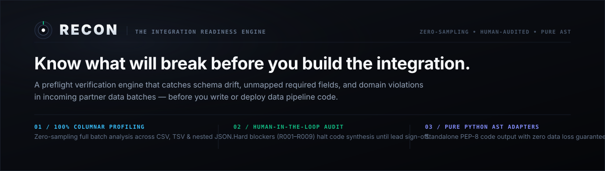
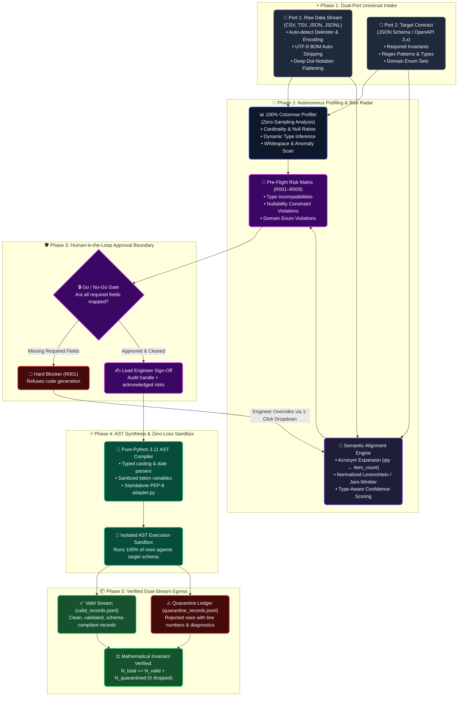
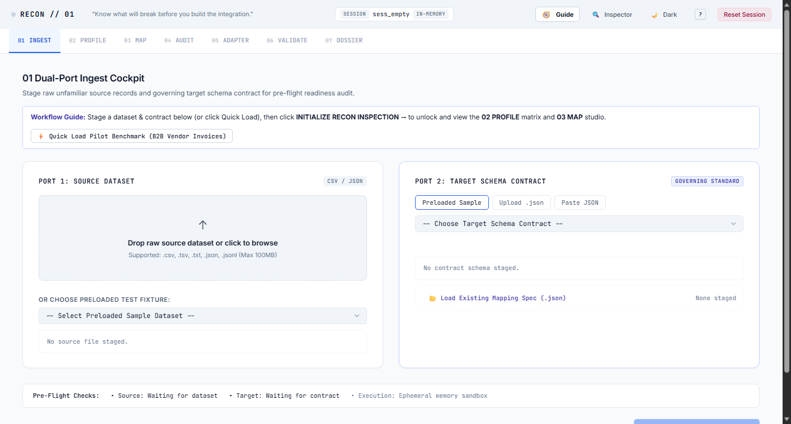
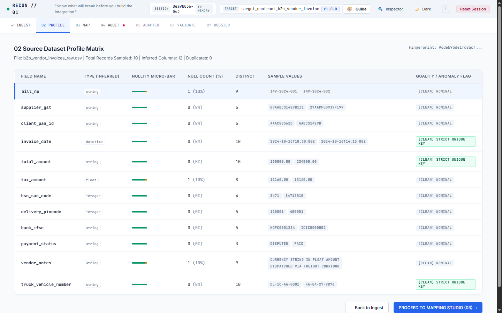
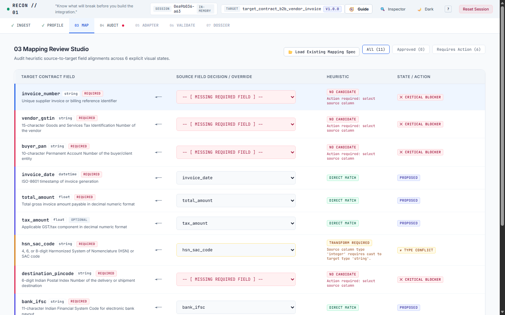
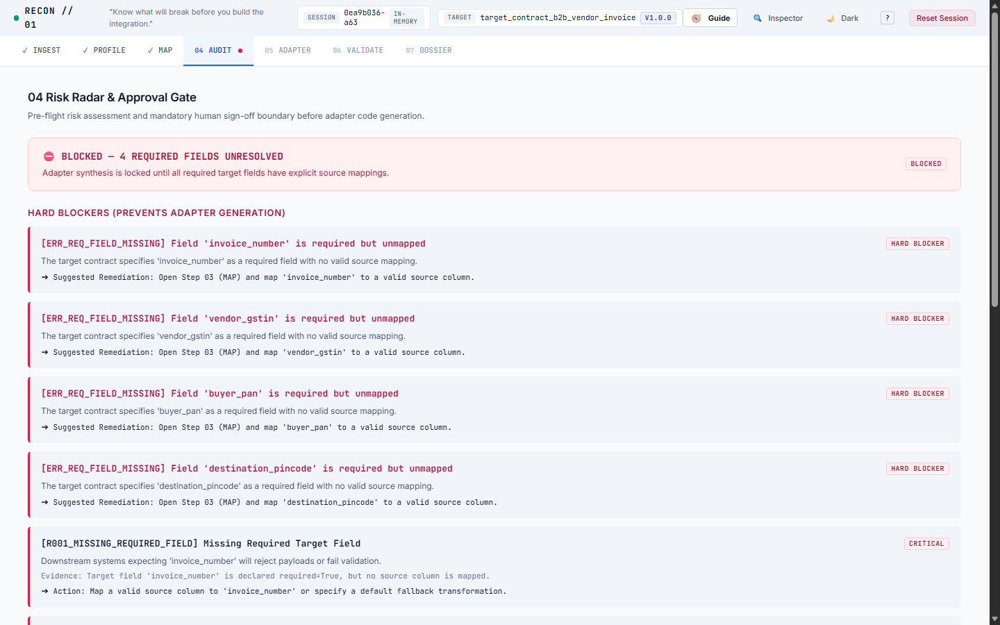
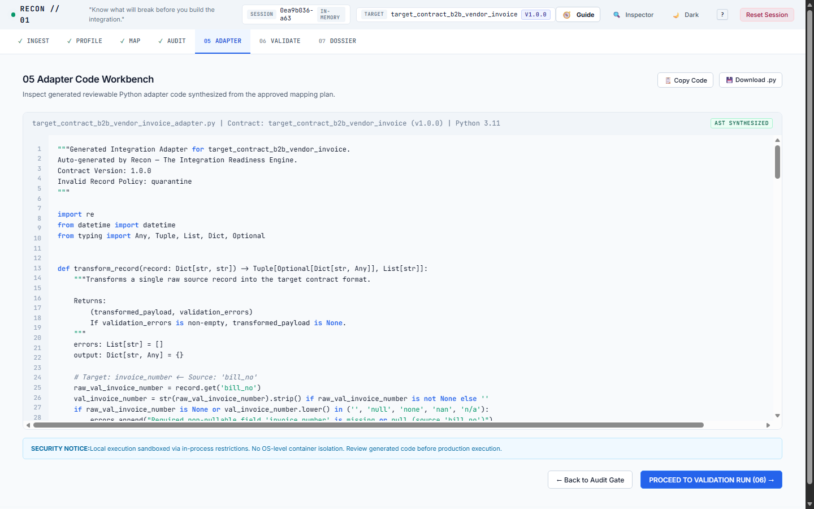
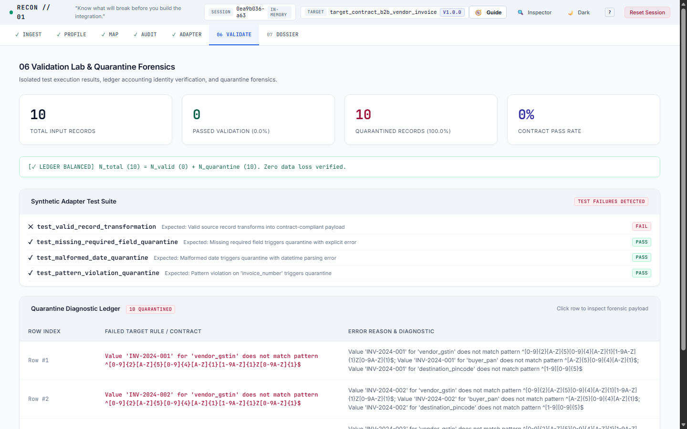
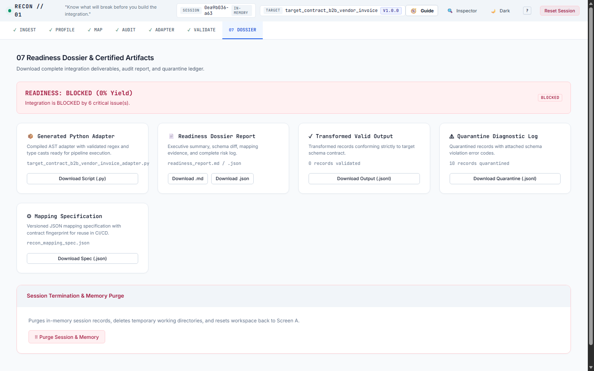

<div align="center">



<br/>
<br/>

<!-- Modern Tech Stack & Status Badges -->
[](https://www.python.org/)
[](https://fastapi.tiangolo.com/)
[](https://docs.pydantic.dev/)
[](https://www.docker.com/)
[](https://github.com/swamigawai/recon/actions)
[](https://docs.pytest.org/)
[](LICENSE)

<br/>

<h3><b>Know what will break before you build the integration.</b></h3>

<p align="center">
  <b>Recon</b> is a developer-first preflight engine that catches mapping gaps, schema mismatches, and data-quality defects in third-party partner data batches <i>before</i> you write or deploy ingestion pipeline code.
</p>

<p align="center">
  <a href="#-quick-start"><b>Quick Start</b></a> •
  <a href="#-the-live-integration-lifecycle"><b>Live Architecture Flow</b></a> •
  <a href="#-visual-studio-tour"><b>Visual Studio Tour</b></a> •
  <a href="#-why-recon-the-paradigm-shift"><b>Why Recon</b></a> •
  <a href="#-cli--cicd-gate"><b>CI/CD Gate</b></a> •
  <a href="#-tech-stack--architecture-foundation"><b>Tech Stack</b></a> •
  <a href="docs/FDE_PLAYBOOK.md"><b>FDE Playbook</b></a> •
  <a href="docs/"><b>Documentation</b></a>
</p>

</div>

---

## 🛠️ Tech Stack & Architecture Foundation

Recon is engineered with modern, production-grade technologies optimized for execution speed, auditability, and zero vendor lock-in:

<div align="center">

| Component | Technology | Role & Capability |
| :--- | :--- | :--- |
| **Language Runtime** | **Python 3.11 / 3.12** | High-performance type hinting, pattern matching, and native AST compilation. |
| **Schema Validation** | **Pydantic v2 (Rust Core)** | Blazing-fast runtime schema validation and contract coercion. |
| **API & Web Server** | **FastAPI + Uvicorn ASGI** | Async REST endpoints, background session cleanup, and sub-millisecond route dispatch. |
| **Code Synthesis** | **Python Abstract Syntax Tree (AST)** | Compiles approved mappings into standalone, reviewable PEP-8 Python scripts. |
| **Testing Harness** | **Pytest + Starlette TestClient** | 160 deterministic unit, integration, and security tests with 100% pass rate. |
| **Frontend Studio** | **Swiss Modern UI + Tailwind CSS** | Zero-latency browser interface with dynamic flow graph and virtualized telemetry. |
| **Containerization** | **Docker & Docker Compose** | Reproducible, isolated local and staging environments with multi-stage builds. |

</div>

---

## ⚡ The Live Integration Lifecycle

Recon replaces brittle scripts and opaque black-box guessing with an auditable, 5-phase deterministic pipeline:



---

## 🎯 Why Recon: The Paradigm Shift

Traditional ETL pipelines fail silently because they treat integration as an ad-hoc scripting exercise after data is already ingested. Recon shifts validation upstream to preflight.

| Dimension | Traditional ETL Scripts | Raw LLMs / Copilots | Recon Readiness Engine |
| :--- | :---: | :---: | :---: |
| **Data Quality Scan** | Ad-hoc runtime crashes | Blind prompt assumption | **Deterministic 100% Columnar Preflight** |
| **Hallucination Risk** | High (accidental column mis-mapping) | Extreme (silent field hallucination) | **Zero (Refuses to guess; human approval gate)** |
| **Data Loss Policy** | Drops rows or crashes silently | Unpredictable loss | **Zero-Loss Guarantee ($N_{\text{in}} \equiv N_{\text{val}} + N_{\text{quar}}$)** |
| **Output Deliverable** | Monolithic proprietary runtime | Chat snippet code | **Standalone Python AST Adapter + Audit Dossier** |
| **Telemetry & Privacy** | Cloud SaaS phone-home | Third-party cloud API ingestion | **100% Local-First / Zero Telemetry** |

---

## 📸 Visual Studio Tour

Recon provides an engineering-grade, Linear-inspired dark interface designed for fast keyboard navigation and visual clarity.

<details open>
<summary><b>01 Ingest Cockpit — Dual-Port Intake & Live Staging</b></summary>
<br/>
<p>Drag-and-drop dual-port ingestion for raw datasets and target contracts with cryptographic SHA-256 fingerprinting, automatic encoding detection, and UTF-8 BOM stripping.</p>

</details>

<details>
<summary><b>02 Profile Matrix — Deep Columnar Forensics</b></summary>
<br/>
<p>Calculates null percentages, distinct value cardinalities, whitespace anomalies, and dynamic type distributions across 100% of records without lossy sampling.</p>

</details>

<details>
<summary><b>03 Mapping Studio — Semantic Alignment & SVG Flow Graph</b></summary>
<br/>
<p>High-confidence matches are auto-proposed with transparent match evidence. Ambiguous fields are flagged for 1-click human assignment.</p>

</details>

<details>
<summary><b>04 Risk Radar & Approval Gate — Pre-Flight Flight Check</b></summary>
<br/>
<p>Evaluates 9 deterministic risk rules (R001–R009). Strictly blocks adapter generation if required fields are unmapped; logs warnings for domain enum deviations.</p>

</details>

<details>
<summary><b>05 Adapter Workbench — Pure-Python AST Synthesis</b></summary>
<br/>
<p>Inspects the generated, reviewable Python adapter synthesized from the approved mapping plan. Standalone code with zero proprietary framework lock-in.</p>

</details>

<details>
<summary><b>06 Validation Lab & Quarantine Forensics — Zero-Loss Verification</b></summary>
<br/>
<p>Executes the adapter inside an isolated sandbox. Conforming records stream to valid output; faulty records route to the quarantine ledger with line numbers and violation diagnostics.</p>

</details>

<details>
<summary><b>07 Readiness Dossier — Certified Production Deliverables</b></summary>
<br/>
<p>One-click export for the synthesized Python adapter, valid JSONL output, quarantine exception log, executive markdown audit report, and reusable CI/CD mapping spec.</p>

</details>

---

## 🚀 Quick Start

### 1. Installation (Local Developer Environment)

```bash
# Clone the repository
git clone https://github.com/swamigawai/recon.git
cd recon

# Create and activate virtual environment
python -m venv .venv
source .venv/bin/activate  # On Windows: .venv\Scripts\activate

# Install with development dependencies
pip install --upgrade pip
pip install -e ".[dev]"
```

### 2. Launch the Web Studio

```bash
# One-command FDE launcher (checks runtime, dependencies & opens browser)
python scripts/fde_launcher.py

# Or start the local server directly
recon serve --host 127.0.0.1 --port 8000
```
Open your browser at **[http://127.0.0.1:8000](http://127.0.0.1:8000)** to launch the Recon Studio.

---

## 🤖 CLI & CI/CD Gate

Recon provides a headless CLI command to audit data batches in continuous integration pipelines:

```bash
recon gate \
  --source tests/fixtures/synthetic_nyc_311.csv \
  --contract tests/fixtures/target_contract_service_request.json \
  --max-quarantine-pct 5.0 \
  --json > gate_result.json
```

### CLI Exit Code Contract

| Exit Code | Status | Meaning |
| :---: | :--- | :--- |
| **`0`** | `PASS` | Batch conforms strictly to target contract; quarantine rate within threshold. |
| **`1`** | `FAIL` | Hard risk blocker detected, required fields unmapped, or quarantine threshold breached. |
| **`2`** | `ERROR` | Invalid arguments, malformed input syntax, or unreadable source file. |

---

## 🐳 Docker Deployment

Run Recon inside a lightweight, containerized Alpine environment:

```bash
# Run with Docker Compose
docker-compose up --build -d

# Verify server health
curl http://localhost:8000/api/health
```

---

## 🔒 Security & Privacy Posture

- **Local-First Execution:** Your data never leaves your infrastructure. Recon makes zero outbound calls, uses no external telemetry, and requires no API keys.
- **In-Process AST Sandbox:** Synthesized adapters execute in a Python namespace with dangerous builtins stripped (`__import__`, `open`, `eval`, `exec`, `os`, `sys`, `subprocess`, `socket`).
- **Network Isolation:** Remote `$ref` dereferencing in schema contracts is disabled by default to eliminate Server-Side Request Forgery (SSRF).

Detailed security architecture and threat models are documented in [`docs/SECURITY.md`](docs/SECURITY.md).

---

## 📚 Documentation Index

- [`docs/FDE_PLAYBOOK.md`](docs/FDE_PLAYBOOK.md) — Forward Deployed Engineer standard operating procedures, edge-case resolution, and production deployment patterns.
- [`docs/ARCHITECTURE.md`](docs/ARCHITECTURE.md) — Core engine internals, schemas, and data pipelines.
- [`docs/DEVELOPMENT.md`](docs/DEVELOPMENT.md) — Contributor instructions, testing setup, and coding conventions.
- [`docs/SECURITY.md`](docs/SECURITY.md) — Detailed threat modeling, isolation boundaries, and audit policies.
- [`docs/PILOT_DEVELOPER_GUIDE.md`](docs/PILOT_DEVELOPER_GUIDE.md) — Guide for conducting real-world integration pilot evaluations.
- [`docs/WEBSITE_INTEGRATION.md`](docs/WEBSITE_INTEGRATION.md) — Drop-in web embedding and iframe specifications.
- [`docs/FAQ.md`](docs/FAQ.md) — Frequently asked technical and architectural questions.

---

## 📄 License

Recon is open-source software licensed under the **[MIT License](LICENSE)**.  
Copyright (c) 2026 Swami Gawai.
