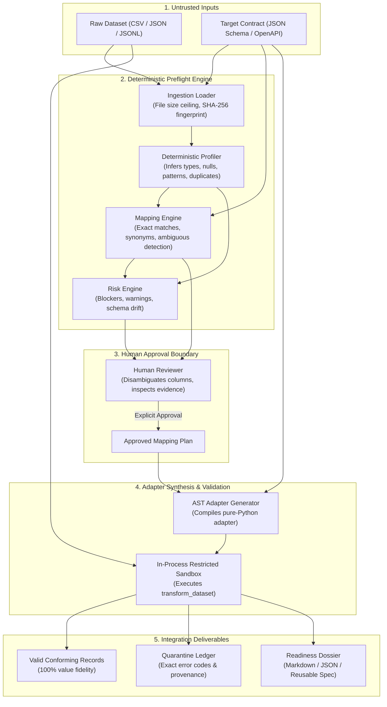
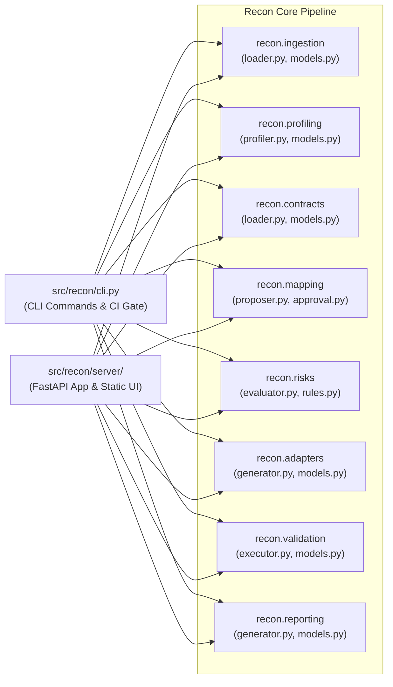
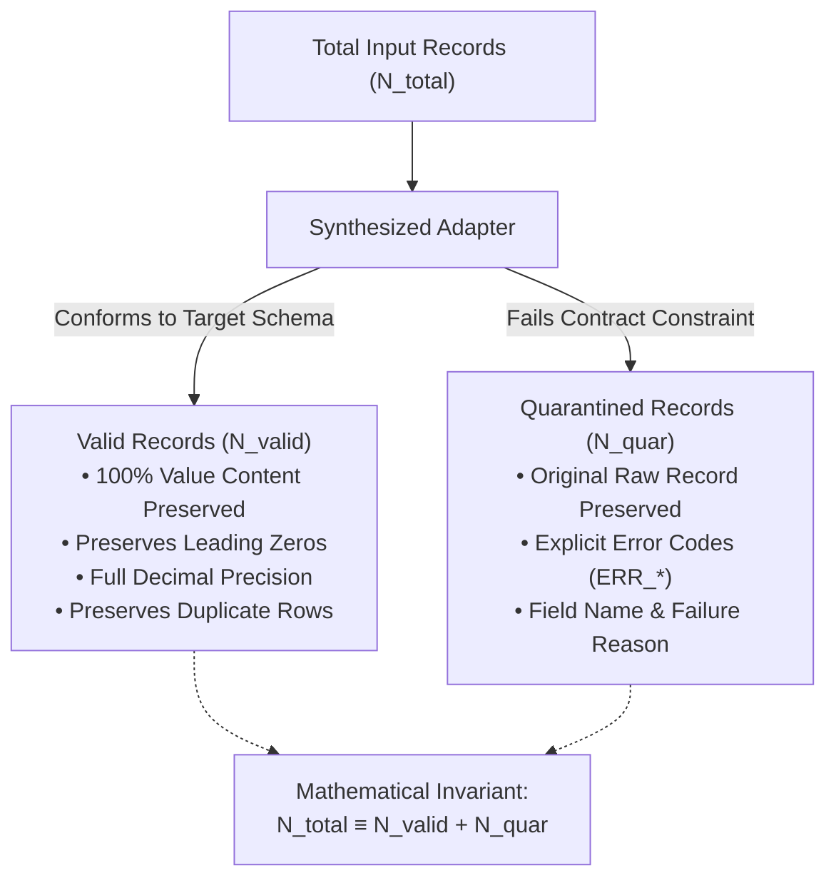
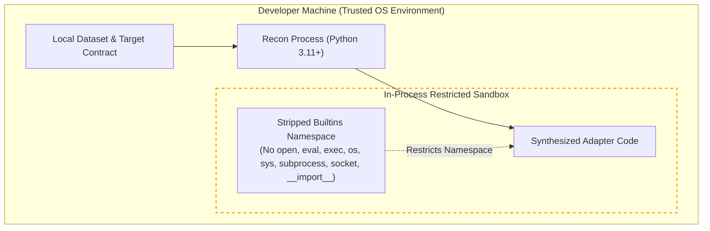

# Recon — Architecture & System Design

**Product:** Recon — The Integration Readiness Engine  
**Repository:** `https://github.com/swamigawai/recon`  
**Status:** `[VERIFIED ARCHITECTURAL SPECIFICATION]`

---

## 1. Architectural Philosophy

Recon is engineered as a **deterministic, evidence-backed preflight engine** designed to evaluate third-party data batches against internal schema contracts *before* ingestion code is written.

### Core Architectural Principles
1. **Deterministic Core:** Counts, types, nulls, and validations are computed with pure Python algorithms. No non-deterministic LLMs make mapping or validation decisions.
2. **Evidence Before Confidence:** Every mapping suggestion and risk finding is backed by verifiable engine evidence (naming heuristics, type compatibility, sample value inspections).
3. **Fail-Closed Ambiguity Guardrails:** When multiple candidate source columns match a target field or a required field lacks a match, Recon marks it `UNRESOLVED` and halts adapter compilation until a human makes an explicit decision.
4. **Zero-Loss Data Accounting:** Every input record is deterministically accounted for as either a valid conforming record or a quarantined record ($N_{\text{total}} \equiv N_{\text{valid}} + N_{\text{quarantine}}$).
5. **Local-First Isolation:** Datasets are processed locally; raw records never leave the developer's machine.

---

## 2. End-to-End Preflight Workflow

The diagram below illustrates the seven-stage preflight pipeline:

---

## 3. Subsystem Architecture & Module Boundaries

Recon is divided into nine decoupled modules in `src/recon/`:

### Module Responsibilities

| Module | Location | Primary Responsibility | Key Data Models / Classes |
| :--- | :--- | :--- | :--- |
| **Ingestion** | `src/recon/ingestion/` | Loads CSV/JSON datasets, checks size limits, computes streaming SHA-256 digests. | `RawDataset`, `IngestionConfig` |
| **Profiling** | `src/recon/profiling/` | Infers column types, tracks nulls, distinct counts, whitespace anomalies, and duplicate rows. | `SourceProfile`, `ColumnProfile`, `InferredType` |
| **Contracts** | `src/recon/contracts/` | Ingests JSON Schema and OpenAPI contracts; blocks remote network refs (`$ref`). | `TargetContract`, `ContractField`, `ContractType` |
| **Mapping** | `src/recon/mapping/` | Generates evidence-backed proposals; identifies ambiguous candidates; enforces human approval. | `MappingPlan`, `FieldMappingProposal`, `MappingStatus` |
| **Risks** | `src/recon/risks/` | Evaluates integration hazards (`R001_MISSING_REQUIRED` to `R008_MAPPING_COLLISION`). | `RiskAssessment`, `RiskFinding`, `RiskSeverity` |
| **Adapters** | `src/recon/adapters/` | Compiles approved mapping plans into standalone, reviewable Python AST adapter code. | `GeneratedAdapter` |
| **Validation** | `src/recon/validation/` | Executes synthesized adapter in a restricted in-process namespace with balanced quarantine accounting. | `ValidationSummary`, `QuarantinedRecord` |
| **Reporting** | `src/recon/reporting/` | Formats comprehensive Markdown and JSON readiness dossiers and versioned mapping specs. | `ReadinessReport`, `ReadinessState` |
| **Server** | `src/recon/server/` | FastAPI REST API and static single-page developer studio (HTML/CSS/JS). | `create_app()`, `/api/state`, `/api/ingest`, etc. |
| **CLI** | `src/recon/cli.py` | Unified terminal entrypoint for profiling, risk auditing, preflight CI gates, and local web serving. | `recon profile`, `recon assess`, `recon gate`, `recon serve` |

---

## 4. Data Accounting & Zero-Loss Invariant

A fundamental guarantee of Recon is that data is never silently dropped, fabricated, or altered during preflight transformation:

### Content Integrity vs Count Accounting
1. **Count Accounting:** Verifies $N_{\text{total}} = N_{\text{valid}} + N_{\text{quarantine}}$.
2. **Content Preservation:** Field-by-field verification against ground truth:
   - String values preserved without integer truncation (`"00142"` $\to$ `"00142"`).
   - High-precision floats preserved within $10^{-7}$ relative tolerance.
   - Multilingual Unicode text and emojis preserved intact.
   - Duplicate rows preserved without unintended deduplication.
   - Null values correctly mapped to nullable target fields.

---

## 5. Security Architecture & Boundary

> [!WARNING]
> **Boundary Notice:** Recon uses an **in-process AST restriction** model for adapter execution. It is **NOT an OS-level sandbox** (no Linux cgroups, namespaces, or seccomp isolation). Recon is designed strictly for **local developer preflight use on trusted local files**, **NOT for public multi-tenant SaaS hosting** of untrusted code.
