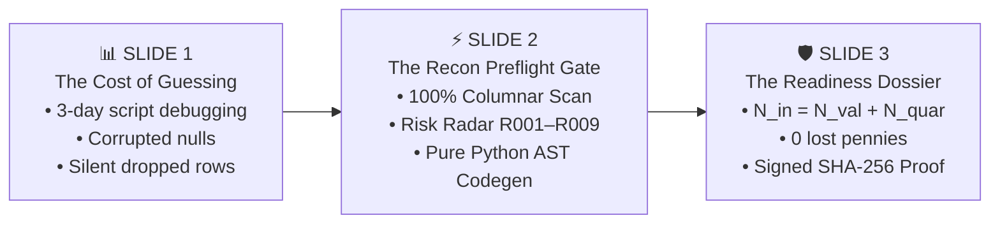

# 📑 RECON // FORWARD DEPLOYED ENGINEERING (FDE) MISSION BRIEF
### Product Design & Delivery Review (PDR-2026-FDE-01)
**Security Classification:** `FIELD OPERATIONAL BRIEF` • **Release Version:** `2.4.0`  
**Core Thesis:** *"Know what will break before you build the integration."*

---

## 1. Executive Summary & Mission Mandate

| Operational Metric | Legacy Status Quo | Recon FDE Standard | Target Objective |
| :--- | :--- | :--- | :--- |
| **Time-to-First-Adapter (TTFA)** | 3 to 10 Business Days | **< 15 Minutes** | **90% Cycle Compression** |
| **Data Loss Invariant** | Silent dropped rows on type error | $\mathbf{N_{total} \equiv N_{valid} + N_{quar}}$ | **100% Cell Accountability** |
| **Compliance Proof** | Raw terminal logs / Slack chats | **Signed SHA-256 Dossier** | **Cryptographic Verification** |
| **Execution Privacy** | Cloud SaaS API phone-home | **100% Air-Gapped Local Execution** | **Zero Outbound Telemetry** |

### The Field Problem
When enterprise partners onboard, they deliver dirty, unstandardized CSV/JSON dumps from legacy mainframes and ERPs. Downstream databases (PostgreSQL, Snowflake, Stripe) enforce strict relational contracts. Traditional ad-hoc transformation scripts cause runtime pipeline crashes, corrupted records, and costly implementation delays.

### The Recon Solution
Recon is a developer-first preflight verification engine that ingests raw partner feeds against destination contracts, profiles 100% of cells without down-sampling, identifies contract drift via a deterministic risk radar (R001–R009), and compiles standalone, reviewable Python AST adapters.

---

## 2. The Four Deliverables in Your FDE Field Packet

When deploying to a client integration pilot, the FDE is equipped with four modular assets:

```
📦 FDE_MISSION_PACKET/
├── 📄 1. docs/FDE_PDR_BRIEF.md         <-- This Executive Brief (Print or save to PDF for leadership)
├── 📘 2. docs/FDE_PLAYBOOK.md          <-- Tactical 7-Stage SOP, Edge Cases & Deployment Patterns
├── 🚀 3. scripts/fde_launcher.py       <-- 1-Touch Studio Launcher (Auto-dependency & port check)
└── 🧪 4. tests/fixtures/               <-- Preflight Flight Simulator (Verified Test Datasets)
```

### Deliverable 1: Executive Mission Brief (This Document)
* **Audience:** Client CTO, VP of Engineering, Enterprise Architect.
* **Purpose:** Explains *why* the integration will succeed, outlines the mathematical guarantees, and establishes the formal definition of integration completion.

### Deliverable 2: FDE Field Playbook (`docs/FDE_PLAYBOOK.md`)
* **Audience:** Forward Deployed Engineer & Integration Developers.
* **Purpose:** Step-by-step Standard Operating Procedure covering:
  * Stage 01: Universal Intake & BOM auto-stripping.
  * Stage 02: 100% Columnar Profiler analysis.
  * Stage 03: Semantic Alignment & manual formula overrides.
  * Stage 04: Preflight Risk Radar (R001 Hard Blockers vs R003/R005 Warnings).
  * Stage 05: AST Adapter synthesis.
  * Stage 06: Zero-loss execution and virtual cell matrix inspection.
  * Stage 07: Cryptographic Readiness Dossier hand-off.

### Deliverable 3: 1-Touch Launcher (`scripts/fde_launcher.py`)
* **Execution:** `python scripts/fde_launcher.py`
* **Features:** Automatically validates Python 3.11+ runtime, checks core dependencies, verifies port 8000 availability, and opens the default browser directly to the Recon Studio.

### Deliverable 4: Preflight Flight Simulator Fixtures
* **Raw Feed:** `tests/fixtures/synthetic_nyc_311.csv` & Desktop `PORT_1_RAW_DATASET_TEST.csv`
* **Target Spec:** `tests/fixtures/target_contract_service_request.json` & Desktop `PORT_2_TARGET_CONTRACT_TEST.json`
* **Purpose:** Allows the FDE to run an immediate 60-second dry run before connecting live client streams.

---

## 3. The 3-Slide Client Pitch (How to Present to Stakeholders)

When you walk into a client architecture review, present these three slides:



1. **Slide 1: "The Status Quo Is Broken"**
   * Traditional ETL scripts fail in production because they make assumptions about data quality. Dropping corrupted rows silently corrupts analytical and financial ledgers.
2. **Slide 2: "Preflight Verification Before Code Deployment"**
   * Recon acts as a compiler for your integration. We scan 100% of rows upfront, refuse to guess when required fields are missing, and force human architectural approval.
3. **Slide 3: "Cryptographic Accountability"**
   * At the end of the run, you don't just get an adapter. You receive a mathematically verified Dossier proving zero records were dropped.

---

## 4. Pilot Acceptance Scorecard

An integration pilot is classified as **SUCCESSFUL** when all five criteria are satisfied:

- [ ] **TTFA Benchmark:** Complete adapter generated and validated in $\le 15\text{ minutes}$.
- [ ] **Hard Blocker Resolution:** Zero unresolved R001 violations (all target required invariants satisfied).
- [ ] **Zero-Loss Mathematical Verification:** 
  $$\text{Total Records Ingested} \equiv \text{Valid Stream} + \text{Quarantine Ledger}$$
- [ ] **Sandbox Safety:** The generated `adapter.py` compiles without warnings and runs with zero external SaaS dependencies.
- [ ] **Dossier Sign-Off:** Client lead engineer formally receives and archives `readiness_dossier.zip` with SHA-256 verification.

---

## 5. Quick Command Reference

```bash
# 1. Launch the Studio Interface
python scripts/fde_launcher.py

# 2. Run Headless CLI Preflight Check
recon gate \
  --source client_raw_batch.csv \
  --contract client_target_schema.json \
  --max-quarantine-pct 2.0 \
  --json

# 3. Docker Air-Gapped Deployment
docker compose up -d
```
