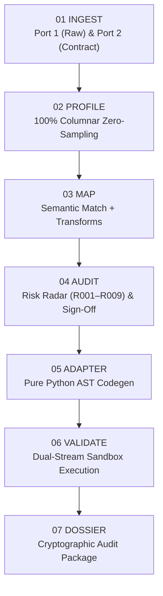

# 🛡️ Recon FDE Field Playbook
### Standard Operating Procedure for Forward Deployed Engineers (FDEs)
> *"Know what will break before you build the integration."*

---

## 1. Executive Mission & FDE Mandate

As a Forward Deployed Engineer (FDE) or Field Solutions Architect, your primary objective during client data onboarding is to **drastically compress Time-to-First-Adapter (TTFA)** while guaranteeing **zero silent data loss**.

Traditional enterprise data onboarding takes **3 to 10 business days** per partner:
* Clients provide unstandardized CSV/JSON files with inconsistent casing, unexpected nulls, and schema drift.
* The destination system (Postgres, Snowflake, Databricks, Stripe, Salesforce) enforces strict typing and rejects malformed payloads.
* Engineers write throwaway Pandas or Python scripts, debug crashes in staging, and silently drop corrupted records.

**Recon eliminates this cycle.** It performs deterministic, zero-sampling preflight verification across 100% of rows, identifies contract gaps in seconds, synthesizes auditable Python AST adapters, and mathematically guarantees zero data loss:

$$\boxed{N_{\text{total}} \equiv N_{\text{valid}} + N_{\text{quarantined}}}$$

---

## 2. 60-Second Field Deployment

Recon is completely **local-first** with zero outbound telemetry or cloud dependencies. You can run it on secure air-gapped client laptops or internal bastions.

### Option A: Quick Launcher (Recommended)
Clone the repository and run the automated FDE launcher:
```bash
git clone https://github.com/swamigawai/recon.git
cd recon
python scripts/fde_launcher.py
```
*Auto-detects Python 3.11+, checks port availability, and launches the Studio at `http://127.0.0.1:8000`.*

### Option B: Docker Compose
For containerized local environments:
```bash
docker compose up -d
```
*Spins up an isolated, non-root container exposed on port 8000 with native health checks.*

### Option C: CLI Headless Mode (For CI/CD & Automated Pipelines)
If running automated checks inside GitHub Actions, GitLab CI, or a shell script:
```bash
# Run headless preflight gate with 0% allowed quarantine
recon gate \
  --source client_feed.csv \
  --contract target_schema.json \
  --strict
```

---

## 3. The 7-Stage Preflight Protocol

Follow this standard operating procedure when ingesting partner data:



### Stage 01: Dual-Port Universal Intake
1. **Port 1 (Raw Data):** Drop the partner's raw batch file (`.csv`, `.tsv`, `.json`, `.jsonl`).
   * *BOM Handling:* Recon automatically strips Windows UTF-8 BOM (`\xef\xbb\xbf`) headers generated by Excel and PowerShell.
   * *Nested JSON:* If the payload is wrapped in an envelope (`data`, `items`, `records`, `results`), Recon automatically discovers the root array.
2. **Port 2 (Target Contract):** Drop the destination schema (`JSON Schema Draft-07` or `OpenAPI 3.x`).
   * Recon extracts all `required` fields, type definitions, regex patterns, and `enum` allowed domains.

### Stage 02: 100% Columnar Profiling
* Recon inspects **every single cell** without down-sampling.
* Review the **Profile Matrix**:
  * **Inferred Types:** Check if numeric identifiers with leading zeros (e.g. `00142`) were preserved as strings.
  * **Null Ratios:** Flag columns with high null rates intended for non-nullable target fields.
  * **Distinct Counts & Cardinality:** Identify categorical columns versus freeform text.

### Stage 03: Semantic Alignment Studio
* Recon computes confidence scores using normalized Levenshtein distance, Jaro-Winkler, and common acronym expansion (e.g., `qty` $\leftrightarrow$ `item_count`, `ts` $\leftrightarrow$ `timestamp`).
* **FDE Action:**
  1. Review suggested mappings (green badges indicates high confidence $\ge 0.85$).
  2. For unmapped or ambiguous fields, use the 1-click dropdown to select the corresponding source column.
  3. For missing target fields with standard defaults, define fallback constant expressions.

### Stage 04: Preflight Risk Radar & Audit Gate
Recon runs 9 deterministic rule checks (R001–R009):
* **R001 (Missing Required Field):** **CRITICAL HARD BLOCKER.** Prevents adapter generation. You *must* map a source column or supply an approved fallback.
* **R003 (Nullability Conflict):** High warning. Source column contains nulls, but target is non-nullable. Rows with nulls will be safely routed to quarantine.
* **R005 (Enum Domain Violation):** High warning. Source contains values outside the target allowed domain. Unmatched rows will quarantine.
* **FDE Action:** Input your engineer handle/email (e.g., `lead-fde@company.com`) and click **Sign-Off & Approve** to unlock Stage 05.

### Stage 05: Standalone AST Adapter Workbench
* Recon's Abstract Syntax Tree compiler generates a clean, standalone, PEP-8 Python script (`adapter.py`).
* **Key Properties:**
  * Zero proprietary runtime dependencies (uses only standard library + Pydantic v2).
  * Explicit per-field type casting and date parsing (`datetime.fromisoformat`).
  * Pure AST compilation: No brittle regex string replacement or runtime `eval()`.
* **FDE Action:** Click **Inspect Adapter Code** to review the generated Python transformation.

### Stage 06: Zero-Loss Validation Lab
* The engine executes the compiled AST adapter in an isolated sandbox against 100% of the raw data rows.
* **Telemetry Verification:**
  * Check the **Zero-Loss Ledger**: Confirm $N_{\text{total}} = N_{\text{valid}} + N_{\text{quarantined}}$.
  * **Valid Stream:** Records meeting 100% of contract constraints.
  * **Quarantine Stream:** Failed records with exact row indices and failure diagnostic reasons (e.g., `Row 14: Enum violation in billing_cycle`).

### Stage 07: Client Hand-Off & Cryptographic Dossier
* Click **Download Readiness Dossier** to receive `readiness_dossier.zip` containing:
  1. `adapter.py` — Standalone Python script ready for deployment.
  2. `valid_records.jsonl` — Clean, schema-compliant payloads.
  3. `quarantine_records.jsonl` — Rejected records with error diagnostics.
  4. `recon_mapping_spec.json` — Reusable, machine-readable mapping specification.
  5. `readiness_report.md` — Executive audit report with SHA-256 fingerprint.

---

## 4. Production Deployment Architectures

Where does the generated `adapter.py` run in production?

### Pattern A: Apache Airflow / Dagster DAG
Drop `adapter.py` into your pipeline DAG folder:
```python
from airflow.decorators import task
from my_integrations.partner_x.adapter import transform_batch

@task
def ingest_partner_data():
    raw_records = extract_from_s3("s3://bucket/incoming/feed.csv")
    valid_stream, quarantine_stream = transform_batch(raw_records)
    
    # Load valid directly to warehouse
    load_to_snowflake("analytics.partner_table", valid_stream)
    
    # Route quarantine to incident DLQ
    publish_to_dlq("quarantine_topic", quarantine_stream)
```

### Pattern B: Event-Driven AWS Lambda / Cloud Run
```python
import json
from adapter import transform_record

def lambda_handler(event, context):
    raw_payload = json.loads(event["body"])
    result = transform_record(raw_payload)
    
    if result.is_valid:
        forward_to_internal_api(result.data)
        return {"statusCode": 200, "body": "Ingested"}
    else:
        log_quarantine_to_s3(result.diagnostics)
        return {"statusCode": 422, "body": "Quarantined"}
```

---

## 5. Field Edge-Case & Troubleshooting Matrix

| Challenge | Root Cause | FDE Resolution |
| :--- | :--- | :--- |
| **Excel / PowerShell UTF-8 BOM** | File starts with `\xef\xbb\xbf`, causing header `\ufeffid`. | **Automated in Recon.** Built-in `utf-8-sig` decoding strips BOM cleanly. |
| **Numeric ID with Leading Zeros** | Codes like `0042` parsed as integer `42`. | Target contract declares field `type: string`. Recon preserves leading zeros during AST casting. |
| **Unmapped Required Field (R001)** | Client does not track target field (e.g. `organization_name`). | 1. If constant, enter default in formula transform.<br/>2. If unavailable, request contract owner mark `required=False`. |
| **Unlisted Enum Values (R005)** | Client sends `BI_WEEKLY`, contract expects `MONTHLY`, `ANNUAL`. | Recon quarantines only violating rows. Add mapping dictionary to `adapter.py` if equivalence is agreed upon. |
| **Date Token Variations** | Mixed timestamps: ISO 8601, epoch ms, `MM/DD/YYYY`. | Recon synthesizes multi-format resilient date parsing in AST adapter. |
| **Nested JSON Envelopes** | File wraps records in `{"status": 200, "data": [...]}`. | Recon automatically scans for secondary root keys (`data`, `items`, `records`). |

---

## 6. Client Communication Templates

### Email / Slack: Requesting Schema Clarifications
```text
Hi [Client Lead],

We completed preflight verification on the [Partner Name] data batch using Recon.

Our preflight scan verified 100% of cells against the target production contract. Here is the summary:
- Total Records Processed: [N]
- Schema-Ready Records: [N_valid] ([%])
- Quarantined Records: [N_quar] ([%])

Action Required:
1. Field 'organization_name' is declared required by the destination system, but is absent in your feed. Can we map this to an existing field or supply a default?
2. 3 records contained 'payment_status' = 'REFUND_PENDING', which is outside the accepted domain ['PAID', 'PENDING', 'OVERDUE']. 

Attached is our signed Cryptographic Readiness Dossier (SHA-256: [hash[:16]]) detailing row-by-row diagnostics.

Best regards,
[FDE Name] — Forward Deployed Engineering
```

---

## 7. FDE Preflight Checklist

Before declaring an integration ready for production, verify:
* [ ] 100% of source columns profiled with zero sampling.
* [ ] All R001 Hard Blockers resolved (zero unmapped required fields).
* [ ] Lead Engineer sign-off recorded with valid handle/email.
* [ ] Zero-Loss Invariant verified: $N_{\text{total}} \equiv N_{\text{valid}} + N_{\text{quarantined}}$.
* [ ] Downloaded `readiness_dossier.zip` archived in project repository.
* [ ] Generated `adapter.py` unit tested inside CI/CD with `pytest`.
